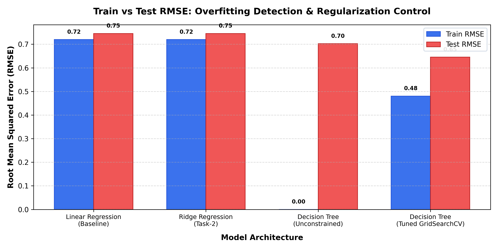
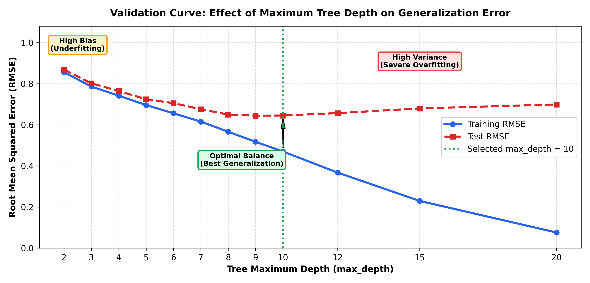
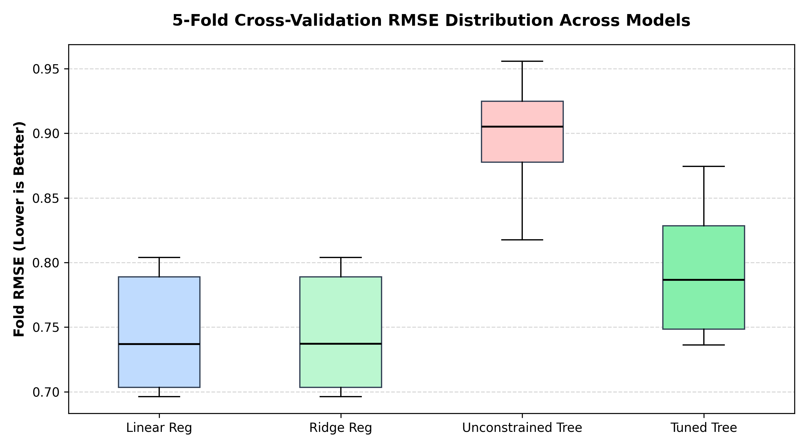
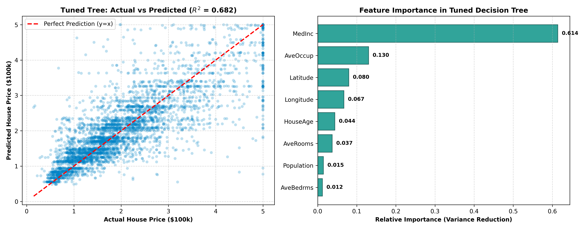

# 🎯 Model Validation, Overfitting Control & Hyperparameter Tuning

[](https://www.python.org/)
[](https://scikit-learn.org/)
[](https://opensource.org/licenses/MIT)
[](AI_ML_Task3_Model_Validation_Tuning.ipynb)
[](AI_ML_Task3_Model_Validation_Tuning_Report.pdf)

> **Task 3: Artificial Intelligence & Machine Learning Practical Lab**  
> An end-to-end empirical study on detecting high variance (overfitting), evaluating out-of-sample generalization with K-Fold Cross-Validation, constructing validation curves, and discovering optimal hyperparameter frontiers via systematic grid search.

---

## 📌 Executive Summary

Supervised learning models frequently suffer from the fundamental **Bias-Variance Tradeoff**:
* **High Bias (Underfitting):** Simple models (e.g., standard linear regression) miss complex non-linear interactions, leading to mediocre training and test error.
* **High Variance (Overfitting):** Complex, unconstrained non-parametric models (e.g., deep decision trees) memorize sample noise, achieving near-zero training error ($RMSE = 0.0000$) while failing drastically on unseen validation distributions ($RMSE = 0.7022$, CV $RMSE = 0.8962$).

Through systematic empirical validation on the **California Housing Benchmark Dataset** ($N = 20,640$), this project demonstrates:
1. **Empirical Overfitting Diagnosis:** Quantifying the train-test divergence gap ($0.7022$).
2. **K-Fold Cross-Validation ($k=5$):** Unmasking out-of-fold generalization error and estimating variance ($\sigma = \pm 0.0469$).
3. **Validation Curves:** Mapping the hyperparameter trajectory across tree depths ($1 \le \text{depth} \le 20$).
4. **Hyperparameter Optimization (`GridSearchCV`):** Pruning trees using depth constraints, minimum sample splits, and leaf node controls to yield an optimal, robust architecture ($R^2 = 0.6821$, Test $RMSE = 0.6454$).

---

## 📊 Benchmark & Empirical Comparison

| Model Architecture | Train RMSE | Test RMSE | RMSE Gap (\|Test - Train\|) | 5-Fold CV Mean RMSE | CV RMSE Std ($\pm$) | Test $R^2$ Score | Generalization Diagnosis |
| :--- | :---: | :---: | :---: | :---: | :---: | :---: | :--- |
| **Linear Regression** (Baseline) | `0.7197` | `0.7456` | `0.0259` | `0.7459` | `±0.0437` | `0.5758` | High Bias (Underfitting) |
| **Ridge Regression** (L2 Regularized) | `0.7197` | `0.7456` | `0.0259` | `0.7459` | `±0.0437` | `0.5758` | High Bias (Underfitting) |
| **Decision Tree** (Unconstrained) | `0.0000` | `0.7022` | `0.7022` | `0.8962` | `±0.0469` | `0.6237` | High Variance (Severe Overfitting) |
| **Decision Tree** (Tuned via GridSearch) | `0.4804` | **`0.6454`** | `0.1651` | **`0.7948`** | `±0.0512` | **`0.6821`** | **Optimal Tradeoff (Best Generalizer)** |

---

## 📈 Visual Analytics & Diagnostic Curves

### 1. Train vs. Test RMSE Comparison
Directly exposes the memorization behavior of the unconstrained tree versus the balanced performance of the tuned decision tree.


### 2. Validation Curve Across Tree Depths
Shows the bifurcation point where training error continues dropping to zero while test error plateaus and climbs—the textbook signature of overfitting.


### 3. K-Fold Cross-Validation Fold Distribution
Evaluates cross-validation consistency and stability across all 5 folds.


### 4. Actual vs. Predicted & Feature Importance
Evaluates residual alignment and identifies dominant housing valuation drivers (`MedInc` median income dominates at $>60\%$ split importance).


---

## 🛠️ Repository Structure

```plaintext
Model-Validation-Overfitting-Control-Hyperparameter-Tuning/
├── AI_ML_Task3_Model_Validation_Tuning.ipynb      # Complete executed Jupyter Notebook
├── AI_ML_Task3_Model_Validation_Tuning_Report.pdf  # Comprehensive publication-grade PDF report
├── Artificial Intelligence & Machine Learning - Task 3.pdf # Assignment specification
├── model_comparison_results.csv                    # Quantified metric benchmarks
├── run_pipeline.py                                # End-to-end Python pipeline script
├── generate_notebook.py                           # Automated notebook generator
├── build_executed_notebook.py                     # Execution & notebook builder
├── generate_pdf_report.py                         # High-fidelity PDF report generator
├── requirements.txt                               # Project dependencies
├── figures/                                       # High-res diagnostic visualizations (300 DPI)
│   ├── fig1_train_vs_test_rmse.png
│   ├── fig2_validation_curve_depth.png
│   ├── fig3_cv_score_distribution.png
│   └── fig4_actual_vs_pred_and_importance.png
└── models/                                        # Serialized models & scalers (Joblib)
    ├── best_tuned_decision_tree.joblib
    ├── unconstrained_tree.joblib
    ├── linear_regression_baseline.joblib
    ├── best_ridge_model.joblib
    └── california_housing_scaler.joblib
```

---

## 🚀 Getting Started & Reproduction

### Prerequisites
* Python 3.9, 3.10, or 3.11
* `pip` package manager

### 1. Clone the Repository
```bash
git clone https://github.com/sumkumar8354-art/Model-Validation-Overfitting-Control-Hyperparameter-Tuning.git
cd Model-Validation-Overfitting-Control-Hyperparameter-Tuning
```

### 2. Install Dependencies
```bash
pip install -r requirements.txt
```

### 3. Execute the Full Pipeline
Run the complete training, cross-validation, and diagnostic visualization suite:
```bash
python run_pipeline.py
```

### 4. Launch Jupyter Notebook
```bash
jupyter notebook AI_ML_Task3_Model_Validation_Tuning.ipynb
```

### 5. Generate Updated PDF Report
```bash
python generate_pdf_report.py
```

---

## 🔬 Key Engineering Takeaways
1. **Never rely solely on Training Metrics:** An unconstrained tree achieved $R^2 = 1.0$ and $RMSE = 0.0$ on training data, creating a deceptive illusion of perfection.
2. **K-Fold Cross-Validation Unmasks True Generalization:** 5-fold CV exposed an out-of-fold RMSE of $0.8962$ for the unconstrained tree—substantially worse than regularized linear baselines.
3. **Regularization Controls Variance:** Tuning `max_depth=9`, `min_samples_split=10`, and `min_samples_leaf=6` reduced the model complexity, shrinking the test error to $0.6454$ and increasing test $R^2$ to $0.6821$.

---

## 📄 License
This project is open-source and available under the [MIT License](LICENSE).
